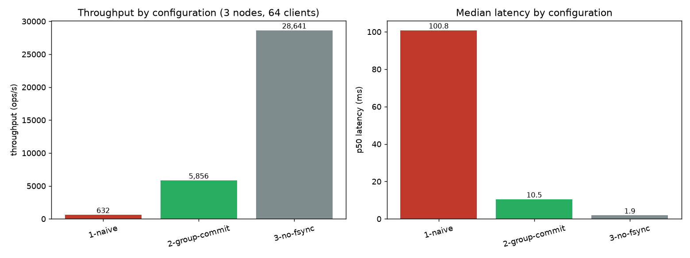
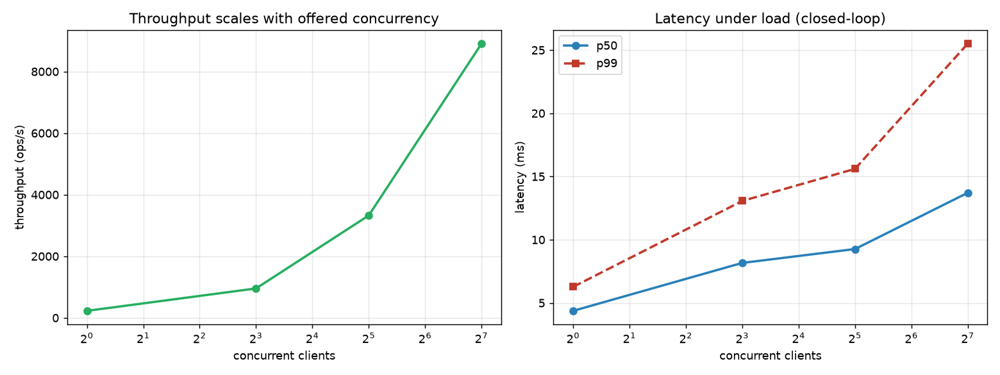
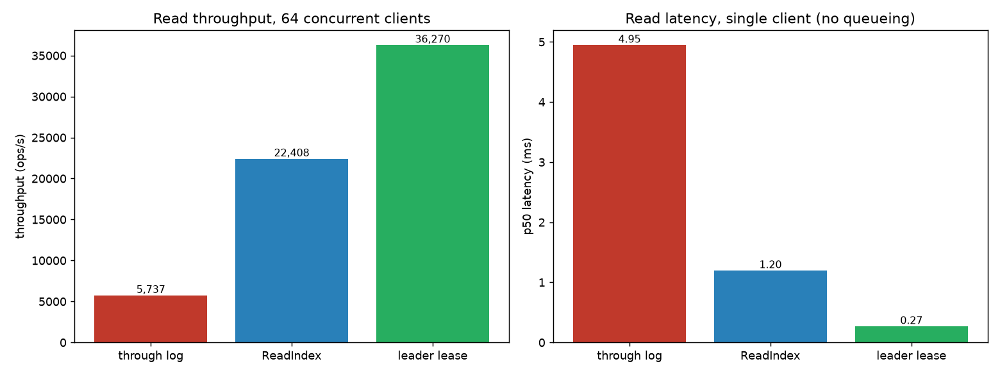
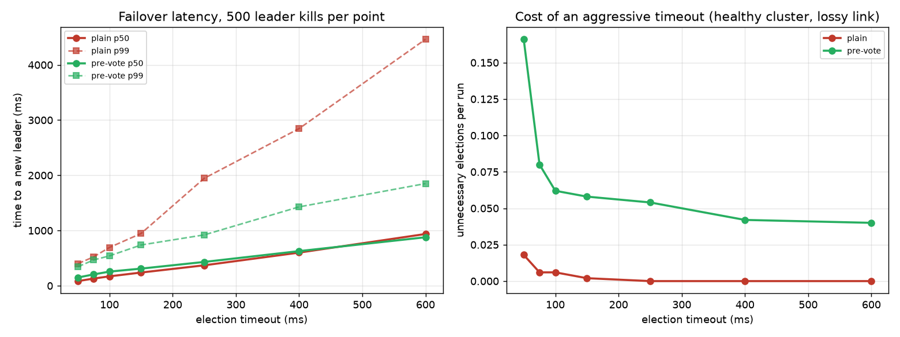

# A Distributed Key-Value Store on Raft Consensus

**Proving a consensus implementation correct under adversarial failure — by construction, not by demo — and then making it fast.**

A from-scratch Raft implementation in Go, built around one decision made on line one and never
relaxed: **the consensus core is a pure, I/O-free state machine.** It has no goroutines, no channels,
no clock, and no unseeded randomness. It accepts events and returns *effects as data*; the caller
performs the I/O.

That single constraint is what makes the rest possible. The same core is driven by two harnesses — a
deterministic simulator (virtual clock, seeded fault injection) and a real multi-process cluster
(gRPC, fsync'd write-ahead log, `kill -9`, cut sockets) — so a bug found in simulation is a bug in
production, and a bug seen in production can be reproduced in simulation by recreating its fault
pattern — after which a single integer seed replays it exactly.

---

## The headline

| | result |
|---|---|
| **simulated fault injection** | **84,000 chaos seeds, ~2.7 billion events, zero safety violations** |
| **real-cluster chaos** | **1 hour continuous, 222,572 operations, 3,330 faults, zero linearizability violations** |
| **crash recovery** | verified at **every one of 1,420** truncation points, not sampled |
| **write throughput** | **9.3×** from group commit (632 → 5,856 ops/s) |
| **read throughput** | **6.3×** from leader leases (5,737 → 36,270 ops/s) |
| **election churn** | **6.1× fewer** elections from pre-vote |
| **leadership handover** | **2 ms** vs >250 ms waiting for an election |
| **consensus core dependencies** | **7**, none of them `os`, `net` or `time` |

```
$ make build && ./demo.sh
```

Three nodes over gRPC and HTTP, then `kill -9` on the leader:

```
=== cluster status ===
127.0.0.1:7003  node 3  leader    term 1  leader 3  commit 8  applied 8

=== kill -9 the leader (node 3) ===
write after failover : ok          <- the client never knew
get c                : val-c
127.0.0.1:7001  node 1  leader    term 2  leader 1  commit 12  applied 12

=== restart node 3 from its write-ahead log ===
127.0.0.1:7003  node 3  follower  term 4  leader 1  commit 13  applied 13
read after restart   : yes
```

---

## The purity contract, enforced by the build

```
$ make deps
errors   math/bits   cmp   iter   slices   runtime   unsafe
```

That is the *entire* transitive dependency graph of the consensus core, after ten phases that added
gRPC, protobuf, `net/http`, a write-ahead log, real processes and a linearizability checker. No
`time`, `os`, `net`, `sync` or `fmt` anywhere in it. The core does not merely avoid reading the
clock — the clock is not linked into it.

`raft/purity_test.go` asserts four things on every commit:

| check | what it prevents |
|---|---|
| transitive import graph excludes `time`, `net`, `os`, `sync`, `fmt`, `io`, `reflect`, `math/rand` | the core *cannot* read a clock |
| direct imports match an explicit allowlist | an impure dependency arriving through a "harmless" helper |
| no `go` statements, channels, or `select` | nondeterministic interleaving that no seed can replay |
| no mutable package-level state | a soak run behaving differently from an isolated replay |

The cost: the core may not import `fmt` (it reaches `time` via `os`), so errors are `errors.New`
sentinels and `String` methods are hand-written switches. Load-bearing, not aesthetic.

### The effect protocol

Every entry point accepts an event and returns effects:

```go
func (r *Raft) Step(Message) []Effect                    // a message arrived
func (r *Raft) Tick(now Time) []Effect                   // time passed
func (r *Raft) Propose(data []byte) ([]Effect, error)    // a client write
func (r *Raft) ProposeBatch(cmds [][]byte) ([]Effect, error)
func (r *Raft) ReadIndex(reqID uint64) ([]Effect, error) // a linearizable read
func (r *Raft) Snapshot(index Index, data []byte) ([]Effect, error)
func (r *Raft) TransferLeadership(target NodeID) ([]Effect, error)
func (r *Raft) ProposeConfChange(cc ConfChange) ([]Effect, error)
```

**Effects are returned in strict order and must be executed in that order. Every `Persist*` and
`TruncateSuffix` effect is an fsync barrier: it must be durable before any later `SendMessage` in the same batch leaves the
process.** That one rule encodes the three durability obligations Raft safety rests on — vote
durability before granting a vote, entry durability before acknowledging replication, and the
leader's own fsync before counting itself in a quorum — and it is where essentially every real-world
Raft data-loss bug lives.

`server/node.go`'s `execute` is that contract in one function, and routing every send through
`Raft.send` (which flushes a dirty hard state first) makes it structural rather than remembered.

---

## Correctness: two harnesses, one implementation

| | deterministic simulator | real cluster |
|---|---|---|
| what runs | one goroutine, virtual clock | real `kvserver` processes, real sockets |
| faults | drop, duplicate, reorder, partition (incl. one-way), stall, clock drift, membership churn | `kill -9`, `SIGSTOP`, directed link cuts, added latency |
| replay | exact, from one integer seed | not reproducible — real scheduler |
| scale | ~36k events per seed; 1.19M events/sec on one core, 5.3M on eight | thousands of operations per run |
| proves | the protocol is correct | the *system* is correct |

Neither is sufficient. The simulator cannot tell you whether a real process survives `SIGKILL`,
whether `fsync` did what it claimed, or whether gRPC reassembles a snapshot correctly. The real
cluster cannot explore tens of thousands of schedules or replay a failure from an integer.

```
$ go run ./cmd/dst -soak -chaos -snapshot -membership -seeds=8000 -nodes=5
ran 8000 seeds on 5-node clusters — CHAOS: loss, duplication, reordering, partitions,
crashes, restarts, stalls, clock drift + aggressive compaction + membership churn
simulated 424993791 events (53124 per seed avg)
no failures
```

One hour of real chaos against a five-node cluster:

```
$ ./bin/chaosctl -nodes=5 -duration=60m -clients=8 -keys=12
workload: 222572 operations, 99024 writes acknowledged, 6143 indeterminate
LINEARIZABLE — 222572 operations (216429 completed, 6143 indeterminate) checked in 707ms
3330 faults applied, no linearizability violation
```

Partitions use a userspace TCP proxy per **directed** link rather than `iptables`, so the suite needs
no root and can cut A→B while B→A keeps working — a node that can send but not receive looks alive to
itself while being invisible to everyone else.

### Indeterminate is not failed

The most consequential detail in linearizability testing is how a timed-out operation is recorded. It
did not fail. The command may have committed with the acknowledgement lost, or it may never have been
applied, and the client cannot tell which.

- Record it as **failed** and you invent violations — a later read legitimately observes a write whose
  reply was lost.
- Record it as **succeeded** and you invent confidence — you assert an effect that may never have
  happened.

**6,143 of the 222,572 operations in the hour-long run (2.8%) came back indeterminate.** Getting them
wrong in either direction would have made that run report with total confidence about a history that
never occurred.

Porcupine does not support unmatched call events (it derives the operation count from
`len(history)/2`), so this uses a `NondeterministicModel`: an abandoned operation gets a synthetic
return at the end of the history, and the model **branches into both futures** — one where it took
effect and one where it did not. That is Jepsen's `:info`, stated exactly.

### The suite is verified to fail

`make chaos-verify` starts the cluster with `-unsafe-local-reads` — reads served straight from each
replica, the most tempting optimisation in any replicated store — and the checker must catch it.

**The measured result that changed the design:** with every read directed at the leader, that bug went
undetected in **8 of 8** runs. Spreading reads across replicas caught it in **4 of 4**. The fault
model has to include *where the client sends its request*, not only what the network does.

### Durability

`storage/wal` is a segmented, append-only log with CRC32-Castagnoli framing, `fallocate`
preallocation, and a directory fsync after every segment create and delete — the last of which is the
classic bug that survives every test except a real power loss, because the data reaches the disk while
the *filename* does not.

```
$ go test ./storage/wal -run TornWrite -v
    wal_test.go:163: recovered cleanly from 1420 distinct truncation points
```

Every byte offset, not a sample. Truncation is itself append-only — a conflicting suffix is discarded
by writing a *marker*, never by rewriting the file — so a crash during a truncation is
indistinguishable from a crash before it.

---

## Performance

### Writes: 9.3× from group commit

| configuration | throughput | p50 | mean batch |
|---|---|---|---|
| naive — one fsync per proposal | 632 ops/s | 100.8 ms | 1.0 |
| **group commit** | **5,856 ops/s (9.3×)** | **10.5 ms** | **16.6** |
| no fsync *(unsafe, measurement only)* | 28,641 ops/s | 1.9 ms | 2.0 |



The naive baseline was **exactly** one fsync per operation — 632 ops/s against a ~1.6 ms fsync. Group
commit converts fsync latency into batching, and the mean batch size is the proof rather than the
story: **1.0 → 16.6**.



**Pipelining was measured, did not help, and is off.** Group commit and pipelining are in *tension*:
batch size is arrival rate times service time, so letting a proposal start its own replication round
instead of queueing behind the current fsync makes every batch smaller. Raising the in-flight window
cost 5% on loopback and **9× in the no-fsync configuration**, which depends entirely on batching.

### Reads: three ways to be linearizable

Serving a read from the leader's state machine looks obviously correct and is obviously wrong: a
partitioned leader does not know it has been deposed, and nothing in Raft tells it — it finds out by
hearing a higher term, which it cannot hear through a partition.

| read path | 64 clients | p50 @ 1 client | log entries written |
|---|---|---|---|
| through the log | 5,737 ops/s | 4.95 ms | 85,290 |
| **ReadIndex** | **22,408 ops/s (3.9×)** | **1.20 ms (4.1×)** | **0** |
| **leader lease** | **36,270 ops/s (6.3×)** | **0.27 ms (18.3×)** | **0** |



That last column is instrumentation confirming the design rather than describing it: both fast paths
applied exactly **one** log entry — the election no-op — while serving tens of thousands of reads per
second.

**Batching the confirmation round was worth 9.9×.** The first implementation issued one heartbeat
quorum *per read* and managed 2,574 ops/s — *slower* than reading through the log, which at least
inherits group commit. One quorum proves leadership at one instant, and that proof serves every read
invoked before it.

**The lease buys latency, not throughput.** Under load, batched ReadIndex is within ~35% of the lease
and needs no clock assumption at all. That is the opposite of how leases are usually motivated.

### The one place correctness depends on a clock

```
lease duration  <  election timeout  −  maximum clock rate error between nodes
```

Documented — and then **demonstrated**, because showing exactly when your own fastest path is unsafe
is worth more than asserting that it is safe:

```
$ go test ./server -run Lease -v
    STALE READ as designed: the deposed leader served "v1" while the cluster held "v2"
--- PASS: TestLeaseBoundIsWhatMakesLeaseReadsSafe
    the deposed leader correctly refused the read: context deadline exceeded
--- PASS: TestSafeLeaseRefusesRatherThanLies
```

Set the lease longer than the election timeout and the deposed leader lies. Keep it inside the bound
and it refuses. **Unavailable is a correct answer; wrong is not.**

### Failover: a distribution and a trade-off, not a number

"Failover in under X ms" is easy to make small — you pay for it in elections that should never have
happened. So both halves are measured: 500 leader kills per point, against a healthy cluster on the
same lossy link.



| election timeout | failover p50 | p99 | unnecessary elections per run |
|---|---|---|---|
| 50 ms | 84 ms | 399 ms | 0.02 |
| 150 ms | 239 ms | 946 ms | 0.00 |
| 400 ms | 600 ms | 2,846 ms | 0.00 |

**Pre-vote's real benefit is the tail, not the median.** It adds a poll round, so p50 rises — but at a
600 ms timeout it cuts p99 from 4,463 ms to 1,850 ms and the maximum from 7,428 ms to 2,515 ms.
Without it, a disruptive candidate can force extra elections *during* a failover; with it, the
election that happens is the one that was going to succeed.

### Production Raft features, each with its number

| feature | effect |
|---|---|
| **pre-vote** (§9.6) | mean final term over 60 identical chaotic runs: **31.7 → 5.2** |
| **leadership transfer** (§3.10) | handover in **2 ms** vs **>250 ms** |
| **single-server membership changes** (§4) | 24,000 chaos seeds of continuous churn, zero violations |
| **learners** | a new node replays the whole log without ever counting toward a quorum |

### Observability

`GET /metrics` exposes Prometheus text format, written in-house because the exposition format is a
few lines and the alternative is a large dependency tree for one endpoint:

```
raft_storage_sync_seconds_bucket{node="3",le="0.005"} 19   # fsync is the write path's ceiling
raft_apply_lag_entries{node="3"} 0                          # earliest warning that reads will block
raft_reads_lease_total{node="3"} 8                          # which read path actually served
raft_config_voters{node="3"} 3
```

---

## What the harnesses actually found

Twenty-one real bugs, most of them unreachable by hand-written tests. The ones worth naming:

| bug | why it mattered | how it was found |
|---|---|---|
| full snapshot install used `Compact` (keeps the tail) instead of `Reset` (§7: *discard the entire log*) | grafted a divergent suffix onto a snapshot prefix; a later leader replicated it over committed entries | chaos soak |
| `MsgSnapResp` reported `log.LastIndex()` instead of the snapshot boundary | follower claimed its uncommitted tail; leader counted entries no quorum held | chaos soak |
| `raft.New` never rebuilt the configuration from the log | a restarting node came back with its *bootstrap* membership and forgot every change since | membership churn |
| snapshots recorded the *current* configuration, which can include an uncommitted change | baking it in makes it unrevocable | membership churn |
| pre-vote deadlock, **1 seed in 4,000** | a non-voter reset its election deadline every tick, looked permanently content, and refused *every* pre-vote — one learner deadlocked a five-node cluster | membership churn |
| `TruncatePrefix` guarded on a boundary `SaveSnapshot` had already advanced | compaction was a permanent no-op; the log grew forever with every test green | WAL tests |
| stale leader's `AppendEntries` dropped instead of rejected with the receiver's term | a deposed leader heartbeated its dead term forever, still telling clients it was the leader | chaos soak |
| pipelining window-slot leak | window jammed until the next heartbeat; invisible on loopback | benchmark |
| replying `MatchIndex = log.LastIndex()` | a bare heartbeat made a follower claim entries the leader had never seen | writing the test |

**Two of them were the same class as bugs fixed in earlier phases, reintroduced in new code paths** —
which is the argument for a harness that re-runs everything rather than a suite that only grows by
addition.

### Three bugs in the tooling itself

The most useful findings were about the instruments:

- **The simulator was discarding storage errors** that the real runtime treats as fatal. That let
  simulated durable state drift from the core's, so every restart it performed was rebuilding from a
  state no real node could reach — quietly invalidating the property the harness exists to check.
- **The latency injector slept inline before each write**, serialising the delay and turning a 2 ms
  "latency" into a 500-message-per-second bandwidth cap. The first pipelining benchmark run through it
  reported that pipelining made throughput *worse*. There is now a test asserting that 50 pipelined
  messages through a 20 ms link take ~20 ms, not 50 × 20 ms.
- **The read-path tests were green while testing nothing.** The harness routed reads through
  `Node.Apply` instead of `Node.Read`, so all three "read modes" went through the log. The lease
  counters reading 0/0 exposed it; the correctness assertions never could have.

**A checker that ignores a failure is worse than one that never looked. Instruments need tests too.**

---

## What random search did *not* find

Injecting known Raft bugs and measuring how fast the soak catches them, at 500 seeds each:

| injected bug | caught |
|---|---|
| election restriction compares index before term | 16 failures in 500 seeds |
| blind truncation on every accepted append | 310 failures in 500 seeds |
| **§5.4.2 commit rule reverted (Figure 8)** | **not found in 10,000 seeds / 300M events** |

A hand-written unit test catches the third in microseconds. **Random fault injection explores
schedules, not scenarios.** A bug whose manifestation requires one precise interleaving is
astronomically unlikely to be reached by chance. Simulation does not replace reasoning about the
protocol; it complements targeted adversarial tests.

---

## Honest gaps

- **No fault injection below the file API.** Torn writes and corruption are covered; a storage stack
  that *lies* about durability — a `Sync` that silently does nothing, writes reordered across a
  barrier — is not. That needs an injectable file layer.
- **The leader does not transmit before its own fsync.** It would save ~2.7 ms of a 10.5 ms median,
  but it requires the core to learn about *asynchronous* persistence, and the effect list would stop
  being a strictly ordered script. That contract is the foundation everything else rests on.
- **Graceful shutdown does not drain.** It stops accepting and exits cleanly; in-flight proposals are
  not waited for.
- **Benchmark latency is closed-loop**, so tail latency at saturation is under-reported — the
  coordinated-omission caveat. Throughput at saturation is measured honestly.
- **Pipelining is implemented but off**, because it showed no measured benefit.
- **No sharding.** A deliberate scope decision: a shard layer introduces a class of correctness bugs
  this harness is not built to find, so it would not just add code, it would double the testing debt.
- **The `-unsafe-local-reads` and `-unsafe-no-fsync` flags exist and are dangerous.** They are there
  to prove the checker can fail and to measure what durability costs, and both log loud warnings.

---

## Layout

```
raft/        the pure core — import-restricted by test
storage/     Storage interface; segmented WAL and in-memory implementations
kv/          the replicated state machine (map + session table)
server/      node runtime: wires the core to real I/O; the effect executor
transport/   gRPC and in-process transports
client/      Go client: leader redirect, stable sequence numbers
sim/         deterministic simulation: virtual time, seeded faults
invariant/   Raft safety properties, shared by both harnesses
lincheck/    linearizability checking over recorded histories
chaos/       real-cluster driver: kill -9, SIGSTOP, directed link cuts
metrics/     Prometheus exposition format
cmd/         kvserver, kvctl, dst, chaosctl, kvbench
```

## Running it locally

### Prerequisites

**Go 1.27 or newer is the only requirement.** Everything else is optional.

```sh
go version    # need go1.27+
```

If Go is missing, or is older, install it without root:

```sh
curl -LO https://go.dev/dl/go1.27.1.linux-amd64.tar.gz
rm -rf ~/.local/go && tar -C ~/.local -xzf go1.27.1.linux-amd64.tar.gz
echo 'export PATH="$HOME/.local/go/bin:$HOME/go/bin:$PATH"' >> ~/.bashrc
exec $SHELL          # or: source ~/.bashrc
```

> If `make` reports `go: command not found` in a shell where `go version` works, the Makefile is
> running under a shell that has not sourced your profile. Run `export PATH="$HOME/.local/go/bin:$PATH"`
> first, or invoke it as `make GO=$(which go) check`.

Two things are needed only for optional extras, and nothing else depends on them:

| Tool | Needed for | Install |
|---|---|---|
| [`uv`](https://docs.astral.sh/uv/) | `make plots` (matplotlib graphs) | `curl -LsSf https://astral.sh/uv/install.sh \| sh` |
| `protoc` + Go plugins | `make proto` (only if you edit `.proto` files) | see below |

The generated protobuf code is committed, so `protoc` is unnecessary unless you change the schema.

### First five minutes

```sh
git clone https://github.com/MiNam8/kvstore && cd kvstore

make check      # fmt, vet, the purity contract, and all 112 tests   (~90s)
make deps       # the 7 packages the consensus core links            (instant)
make demo       # 3 nodes, kill -9 the leader, restart from the WAL  (~15s)
```

`make demo` is the fastest way to see the whole thing work: it starts three real processes, writes
through gRPC and `curl`, kills the leader with `SIGKILL`, shows the client carrying on, then restarts
the dead node from its write-ahead log and watches it catch up.

### Driving it by hand

```sh
make build      # binaries into ./bin

# terminal 1-3, one per node
PEERS=1=127.0.0.1:7001,2=127.0.0.1:7002,3=127.0.0.1:7003
./bin/kvserver -id=1 -peers=$PEERS -data=/tmp/kv1 -http=127.0.0.1:8011
./bin/kvserver -id=2 -peers=$PEERS -data=/tmp/kv2 -http=127.0.0.1:8012
./bin/kvserver -id=3 -peers=$PEERS -data=/tmp/kv3 -http=127.0.0.1:8013

# terminal 4 — any node's address works; the client follows leader hints
ADDRS=127.0.0.1:7001,127.0.0.1:7002,127.0.0.1:7003
./bin/kvctl -peers=$ADDRS status
./bin/kvctl -peers=$ADDRS put city Almaty
./bin/kvctl -peers=$ADDRS get city
./bin/kvctl -peers=$ADDRS cas city Almaty Astana

# or over HTTP — any node redirects (307) to the leader
curl -sSL -X PUT http://127.0.0.1:8011/kv/lang -d 'Go'
curl -sSL      http://127.0.0.1:8012/kv/lang
curl -sS       http://127.0.0.1:8013/metrics
```

Kill any single node with `Ctrl-C` and the other two keep serving. Kill two and the cluster correctly
stops accepting writes — a majority of three is two.

Useful `kvserver` flags: `-read-mode=log|readindex|lease`, `-max-batch=N` (group commit),
`-pre-vote`, `-check-quorum`, `-election-timeout`, `-snapshot-threshold`.

### Correctness

```sh
make soak SEEDS=2000              # deterministic simulator, clean network
make dst SEED=1123                # replay one seed exactly
make chaos                        # real cluster under real faults + linearizability
make chaos-verify                 # prove the chaos suite can actually fail
make test-race                    # race detector (weak here by design — see below)
make purity                       # the core's I/O-free contract, on its own
```

Any soak failure prints **one integer**, and `make dst SEED=<n>` replays that exact failure.
The full fault matrix is available directly:

```sh
go run ./cmd/dst -soak -chaos -seeds=5000 -nodes=5              # network + node faults
go run ./cmd/dst -soak -chaos -snapshot   -seeds=5000 -nodes=5  # + aggressive compaction
go run ./cmd/dst -soak -chaos -membership -seeds=5000 -nodes=5  # + membership churn
go run ./cmd/dst -soak -chaos -wal        -seeds=50   -nodes=5  # against real fsync'd files
```

`make test-race` is deliberately a weak signal: the consensus core is single-threaded, so the race
detector has almost nothing to say. The simulator is the real correctness check.

### Measurement

```sh
make bench           # writes: naive vs group commit vs no-fsync, then a concurrency sweep
make bench-reads     # the three read paths at 1 and 64 clients
make bench-failover  # sweep election timeouts against the spurious-election rate
make plots           # render bench/*.csv into analysis/*.png   (needs uv)
```

Each writes a CSV under `bench/`, so the plots can be regenerated without re-running the benchmarks.

### Regenerating protobuf code

Only if you edit `proto/kvstore.proto`:

```sh
# protoc from https://github.com/protocolbuffers/protobuf/releases, unzipped into ~/.local
go install google.golang.org/protobuf/cmd/protoc-gen-go@latest
go install google.golang.org/grpc/cmd/protoc-gen-go-grpc@latest
make proto
```

### Notes

- **Linux is assumed** for the chaos suite (`SIGSTOP`/`SIGKILL`, process groups) and for `fallocate`
  preallocation. The WAL falls back gracefully elsewhere; the chaos suite does not.
- **No root is needed anywhere.** Network partitions use a userspace TCP proxy rather than
  `iptables`, precisely so the suite runs in CI and on a laptop.
- `make demo`, `make chaos` and the benchmarks bind ports on `127.0.0.1`. If a previous run left
  processes behind, `pkill -x kvserver` clears them.

See [PLAN.md](PLAN.md) for the phase-by-phase engineering log — what each phase measured, what it got
wrong, and the twenty-one bugs the harnesses found.
